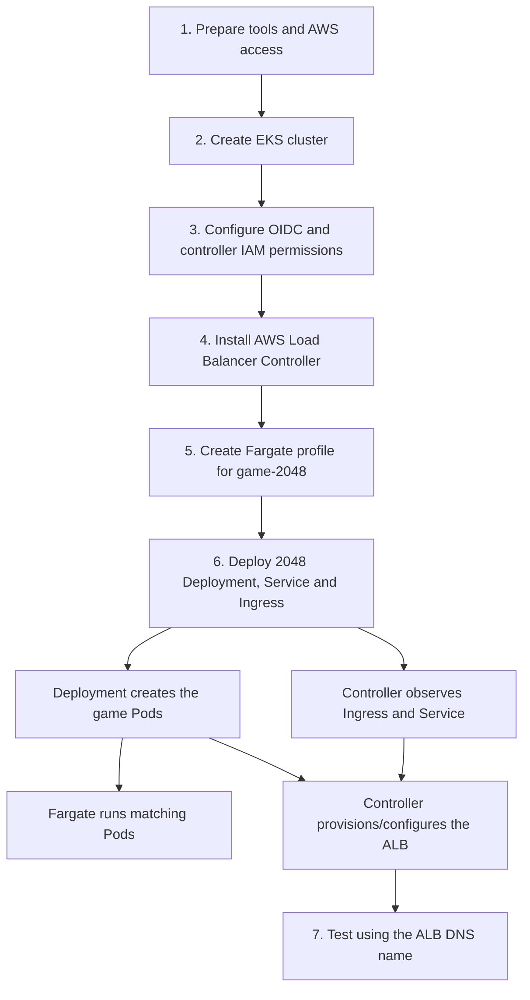
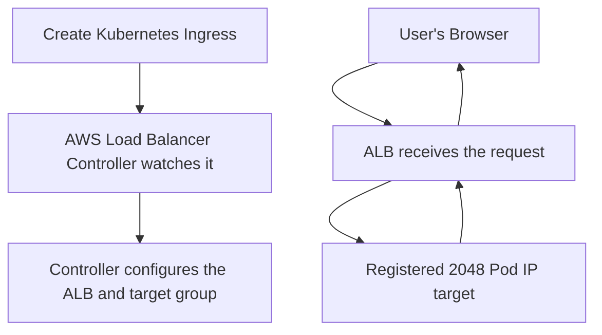

# Deploying the 2048 Game on Amazon EKS with Fargate and ALB

## Project Overview

This project deploys the **2048 game** on Amazon EKS. The game runs in
Kubernetes Pods on **AWS Fargate**, and an **AWS Application Load
Balancer (ALB)** exposes it to users over the internet.

The project demonstrates EKS setup, Fargate workload selection, IAM/OIDC
permissions, Kubernetes application resources, and automated ALB
provisioning.

## Flow Diagram: What Leads to What?



The setup has two connected outcomes: the **Deployment and Fargate
profile get the game running**, while the **Ingress and AWS Load
Balancer Controller make it reachable through an ALB**.


### How Ingress, the Controller, and the ALB Work Together

In this project, **Ingress defines the routing rules, the AWS Load Balancer Controller applies those rules to AWS, and the ALB handles incoming traffic.**




## Step-by-Step Guide

### 1. Prepare tools and AWS access

**Purpose:** Prepare AWS CLI, `eksctl`, `kubectl`, and Helm, plus
credentials with the required permissions. These tools are used for AWS
operations, EKS setup, Kubernetes resources, and controller
installation.

### 2. Create the EKS cluster

**Purpose:** Create `demo-cluster`, which provides the managed
Kubernetes control plane and the AWS environment for the project.

After the cluster is created, configure `kubectl` to connect to it:

``` bash
aws eks update-kubeconfig --name demo-cluster --region us-east-1
```

This updates your local kubeconfig so `kubectl` knows how to connect to
the EKS cluster. Verify the connection with:

``` bash
kubectl get namespaces
```

### 3. Configure OIDC and IAM permissions

**Purpose:** Give the AWS Load Balancer Controller an authorized
identity and the AWS permissions it needs to create and manage
load-balancer resources. This avoids storing long-lived AWS access keys
in the controller Pod.

### 4. Install the AWS Load Balancer Controller

**Purpose:** Run the controller in the cluster so it can watch the
Ingress and related Service configuration and reconcile it with AWS
load-balancer resources.

### 5. Create the Fargate profile

**Purpose:** Create profile `alb-sample-app` for the `game-2048`
namespace. The namespace organizes the game's Kubernetes resources; the
profile selects matching Pods to run on Fargate. It does not deploy the
game.


### 6. Deploy the 2048 application

**Purpose:** Apply the Kubernetes manifest that defines the
application's resources: - **Deployment:** declares the desired
application Pods. - **Service:** selects the game Pods and specifies the
backend port. - **Ingress:** declares the HTTP routing rules that the
AWS Load Balancer Controller uses to configure the ALB.

Kubernetes creates the application resources; the controller then
configures the AWS-side load balancer. The application's namespace must
match the Fargate profile selector.

### 7. Verify the game

**Purpose:** Confirm the game Pods are ready, the Service selects the
Pods, the controller is running, and the Ingress receives an ALB
hostname. Open the hostname in a browser to verify the game.

If access fails, inspect Pod status/events, controller logs, IAM
permissions, subnet discovery and security groups, Ingress events, and
the ALB target group's registered targets.

## Why Different Tools Are Used

  ---------------------------------------------------------------------
  Tool                               Role in this project
  ---------------------------------- ----------------------------------
  `eksctl`                           Creates the EKS cluster and
                                     Fargate profile; helps configure
                                     the controller's IAM
                                     service-account association.

  `kubectl`                          Applies and inspects Kubernetes
                                     Deployments, Services, Ingresses,
                                     and Pods.

  AWS CLI                            Checks identity and interacts with
                                     AWS services and IAM.

  Helm                               Installs the AWS Load Balancer
                                     Controller chart.
  ---------------------------------------------------------------------

A Fargate profile is an AWS EKS resource, so it is created using
`eksctl` or AWS APIs/CLI. Deployment, Service, and Ingress are
Kubernetes resources, so they are applied using `kubectl`.

## Key Concepts

-   **EKS:** Managed Kubernetes control plane.
-   **Fargate:** Runs selected Pods without requiring you to manage EC2
    worker nodes for those workloads.
-   **Fargate profile:** Selects Pods by namespace and optional labels.
-   **Namespace:** Logical grouping for Kubernetes resources.
-   **Deployment and Pods:** Define and run the 2048 application.
-   **Service:** Selects the application Pods and specifies how the
    backend is exposed to Kubernetes and the controller.
-   **Ingress:** Kubernetes HTTP routing configuration, not a network
    hop.
-   **AWS Load Balancer Controller:** Watches Kubernetes resources and
    configures AWS load-balancer resources.
-   **ALB:** Receives external web traffic and forwards it to registered
    targets. In this Fargate/IP-target setup, the targets are the
    application's Pod IPs.
-   **OIDC and IAM:** Give the controller an authorized identity and AWS
    permissions.

## Project Summary

1.  Prepare tools and AWS access.
2.  Create the EKS cluster.
3.  Configure OIDC and IAM permissions for the controller.
4.  Install the AWS Load Balancer Controller.
5.  Create the Fargate profile for `game-2048`.
6.  Deploy the 2048 Deployment, Service, and Ingress.
7.  The controller configures the ALB and its Pod IP targets.
8.  Open the ALB DNS name and test the game.


## Quick Review: Key Questions

### 1. Why use EKS instead of managing Kubernetes control-plane components yourself?

EKS manages the Kubernetes control plane, reducing the work of operating
and maintaining components such as the API server and etcd.

### 2. Why use Fargate instead of managing EC2 worker nodes for selected Pods?

Fargate runs selected Pods without requiring you to provision and manage
EC2 worker nodes for those workloads. AWS manages the underlying compute
infrastructure.

### 3. How do Deployments, Pods, labels, selectors, and Services connect?

A Deployment defines the desired replicas and Pod template. It creates
and maintains Pods. Labels identify the Pods, and selectors match those
labels. A Service uses a selector to find the matching Pods and provides
a stable endpoint to reach them.

### 4. What is the difference between Ingress and an ALB?

Ingress is a Kubernetes resource that declares HTTP/HTTPS routing rules.
An ALB is the actual AWS load balancer that receives external traffic.
The AWS Load Balancer Controller translates supported Ingress
configuration into ALB configuration.

### 5. Why does the AWS Load Balancer Controller need IAM permissions and an identity association?

The controller calls AWS APIs to create and manage load-balancer
resources. Its IAM role and Kubernetes service-account identity let it
make those calls with authorized permissions, without storing long-lived
AWS access keys in the Pod.

### 6. How does a browser request reach the application, and how would you troubleshoot failures?

In this project's Fargate/IP-target setup, the path is **Browser → ALB →
2048 Pod IP**. Ingress provides routing configuration; it is not a
network hop. If access fails, check that the Pods are ready, the Service
selects the correct Pods, the Ingress has an ALB hostname, the
controller is running without IAM errors, and the ALB target group and
networking configuration are healthy.


